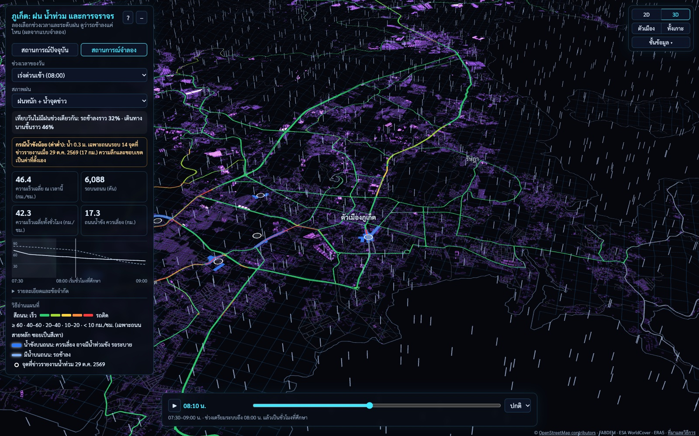

# Ariya Luesawat

**B.Eng. student in Artificial Intelligence and Systems Engineering, Prince of Songkla University, Phuket Campus**

My work covers AI engineering, computer vision, NLP, data processing, simulation, and cloud infrastructure. I focus on systems built from real-world data, and I document their methods and limitations.

---

## Research

### Phuket Native: Rain, Flooding, and Traffic in Phuket

An island-wide traffic simulation of Phuket covering 4,439 km of roads. It estimates how rainfall and standing water reduce traffic speeds at different times of day.

- Traffic volumes are calibrated against 71 traffic count stations.
- A 30 m flood model is coupled to the traffic model, so standing water reduces road speeds instead of closing roads.
- The study includes 180 scenario runs, a sensitivity analysis, and a 2D/3D web viewer.
- The flood model did not pass validation against reported flood locations. The results compare scenarios and should not be used as forecasts.

**Tools:** Python, SUMO (mesoscopic, TraCI), rasterio, NumPy, deck.gl 
**Links:** [Live viewer](https://ariyaluesawat.github.io/phuket-traffic-flood-sim/) · [Repository](https://github.com/AriyaLuesawat/phuket-traffic-flood-sim)

---

## Selected Projects

| Project | Description | Tools | Demo |
| --- | --- | --- | --- |
| [SaiJai Analytics](https://github.com/AriyaLuesawat/Project-saijai) | Expense analytics from Thai bank slips, with OCR text extraction, spending-category prediction, and an interactive dashboard. | Python, FastAPI, EasyOCR, scikit-learn, Next.js | [Live](https://saijaii.vercel.app) |
| [Hand Tracking Air Canvas](https://github.com/AriyaLuesawat/Hand-Tracking-Air-Canvas) | A browser drawing application controlled by webcam hand gestures. Group project, with a software requirements specification. | JavaScript, MediaPipe Hands, HTML Canvas | [Live](https://ariyaluesawat.github.io/Hand-Tracking-Air-Canvas/) |
| [Thailand Road Accident Data](https://github.com/AriyaLuesawat/Project-thailand-road-accident-data) | Thai road-accident records for 2019–2025, translated into English with validation scripts, and a road-safety dashboard. | Python, Excel, Chart.js, Leaflet | [Dashboard](https://ariyaluesawat.github.io/Project-thailand-road-accident-data/Final%20Work/final.html) |
| [EcoLog](https://github.com/AriyaLuesawat/Project-EcoLog) | Air-quality monitoring and personal CO₂ impact tracking, developed with [Nawxtz](https://github.com/Nawxtz). | Next.js, TypeScript, Prisma, SQLite | — |

---

## Technical Skills

| Area | Technologies |
| --- | --- |
| Programming | Python, JavaScript, TypeScript, SQL, C/C++, HTML, CSS |
| AI and data | TensorFlow/Keras, scikit-learn, pandas, NLP, OCR, computer vision, MediaPipe |
| Simulation and geospatial | SUMO traffic simulation, 2D flood modelling on DEMs, rasterio, OpenStreetMap, deck.gl |
| Backend and web | FastAPI, Next.js, React, Prisma, REST APIs |
| Cloud and systems | AWS, Google Cloud AI infrastructure, Tencent Cloud, Linux |
| Networks and tools | Computer networking, MikroTik RouterOS, Git, GitHub |

---

## Coursework and Notes

| Repository | Contents |
| --- | --- |
| [Course Labs](https://github.com/AriyaLuesawat/3rd-courses-lab) | HCD-302 Creating Explainable AI (Labs 1–5) and MCS-201 Hardware Acceleration (Labs 0–4) |
| [Java Parallel Programming Notes](https://github.com/AriyaLuesawat/java-parallel-programming-notes) | Thai-language notes and Java examples for Fork/Join, parallel streams, and CompletableFuture |

---

## Education and Certifications

- **B.Eng. in Artificial Intelligence and Systems Engineering**, Prince of Songkla University, Phuket Campus
- **MikroTik Certified Network Associate (MTCNA)**

## Current Focus

- Deploying AI workloads on cloud GPUs and TPUs
- Designing reproducible evaluation pipelines for machine-learning models
- Building secure, observable services around machine-learning models
